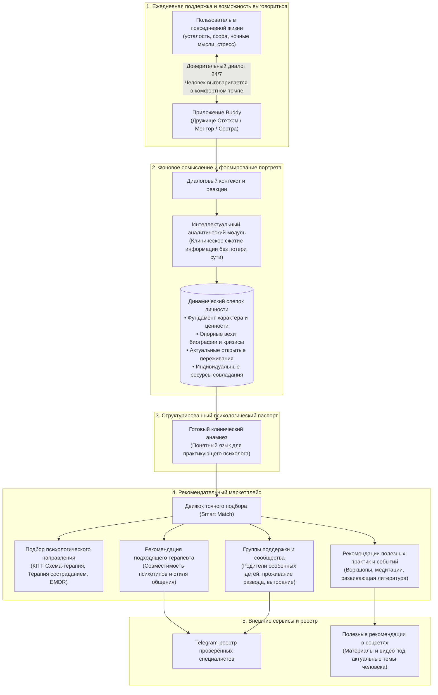

# Платформа Buddy: Экосистема психологической поддержки и персонализированного подбора специалистов

Презентация продукта: от ежедневного доверительного диалога к объективному психологическому портрету и рекомендательному маркетплейсу психологических практик.

---

## Содержание

1. [Концепция платформы Buddy: Задумка и общая схема](#1-концепция-платформы-buddy-задумка-и-общая-схема)
2. [Новый способ познания личности: Диалоговая поддержка вместо статичных анкет](#2-новый-способ-познания-личности-диалоговая-поддержка-вместо-статичных-анкет)
3. [Действующий пилотный продукт: «Дружище Стетхэм»](#3-действующий-пилотный-продукт-дружище-стетхэм)
4. [Линейка персонажей Buddy: Разные стили для разных людей](#4-линейка-персонажей-buddy-разные-стили-для-разных-людей)
5. [Структура психологического портрета (Понятные блоки для специалистов)](#5-структура-психологического-портрета-понятные-блоки-для-специалистов)
6. [Реальные обезличенные портреты пользователей за месяц работы приложения](#6-реальные-обезличенные-портреты-пользователей-за-месяц-работы-приложения)
   - [Портрет 01: IT-инженер и фаундер (соматизация, перфекционизм)](#портрет-01-it-инженер-и-фаундер-соматизация-перфекционизм)
   - [Портрет 02: Руководитель в логистике (преодоление предательства, сарказм)](#портрет-02-руководитель-в-логистике-преодоление-предательства-сарказм)
   - [Портрет 03: Женщина в кризисе одиночества (внутренний критик)](#портрет-03-женщина-в-кризисе-одиночества-внутренний-критик)
   - [Портрет 04: Проживание утраты и бессонница (логика как опора)](#портрет-04-проживание-утраты-и-бессонница-логика-как-опора)
   - [Портрет 05: Сменный рабочий (физический труд, защитный юмор)](#портрет-05-сменный-рабочий-физический-труд-защитный-юмор)
   - [Портрет 06: Мужчина перед браком (предсвадебный стресс, баланс уступок)](#портрет-06-мужчина-перед-браком-предсвадебный-стресс-баланс-уступок)
   - [Портрет 07: Снижение контроля и созерцательный пофигизм](#портрет-07-снижение-контроля-и-созерцательный-пофигизм)
   - [Портрет 08: Обостренная этика и адаптация к смене внешности](#портрет-08-обостренная-этика-и-адаптация-к-смене-внешности)
   - [Портрет 09: Высокая бытовая нагрузка и материнское выгорание](#портрет-09-высокая-бытовая-нагрузка-и-материнское-выгорание)
   - [Портрет 10: Финансовый кризис и отчуждение в браке](#портрет-10-финансовый-кризис-и-отчуждение-в-браке)
7. [Перспектива развития: Рекомендательный маркетплейс и сообщества](#7-перспектива-развития-рекомендательный-маркетплейс-и-сообщества)
8. [Ценность платформы для практикующих психологов и центров](#8-ценность-платформы-для-практикующих-психологов-и-центров)

---

## 1. Концепция платформы Buddy: Задумка и общая схема

Платформа **Buddy** (Бадди) создана для того, чтобы объединить доступную повседневную эмоциональную разгрузку человека с профессиональной системой психологической помощи.

Задумка платформы строится на естественной цепочке:
1. Человек пользуется мобильным AI-собеседником как безопасным пространством, где можно круглосуточно выговориться, сбросить стресс, получить поддержку и взгляд со стороны.
2. В процессе регулярного поддерживающего общения на дистанции недель и месяцев система бережно формирует многомерный психологический портрет личности.
3. Накопленный портрет становится основой для высокоточного, умного подбора психотерапевтических направлений, конкретных специалистов, закрытых групп взаимопомощи и тематических развивающих практик.

---

## 2. Новый способ познания личности: Диалоговая поддержка вместо статичных анкет

В настоящее время основным доступным способом первичного сбора информации о клиенте остаются стандартизированные тесты и онлайн-опросники. Тесты отлично решают задачи скрининга, однако имеют естественные границы:
* Человек садится за тест в определенном состоянии ума и часто дает социально одобряемые ответы.
* Тест представляет собой «моментальный снимок» одного дня и не показывает, как человек справляется со стрессом в динамике.
* Заполнение больших анкет требует значительного ресурса внимания, которого у уставшего или тревожного человека часто просто нет.

Платформа **Buddy** предлагает естественное и экологичное дополнение:
* **Человек не проходит проверку, а просто живет.** Он пишет или наговаривает голосовые сообщения боту в моменты, когда ему тяжело, одиноко или нужно посоветоваться.
* **Снятие психологических защит:** в доверительном разговоре без страха оценки и экзамена человек проявляет свой настоящий язык, подлинные реакции, уязвимости, специфику юмора и триггеры.
* **Наблюдение на дистанции:** система видит развитие ситуации на протяжении двух недель, месяца, трех месяцев. Фиксируется, как угасает или трансформируется конфликт, какие темы повторяются, а какие успешно разрешаются.

---

## 3. Действующий пилотный продукт: «Дружище Стетхэм»

Первым работающим пилотным приложением платформы стал Telegram-бот **«Дружище Стетхэм»**.

* **Сайт проекта:** [https://stethem.apps.aipush.dev](https://stethem.apps.aipush.dev)
* **Telegram-бот:** [@buddy_stethem_bot](https://t.me/buddy_stethem_bot)

  
  
<em>Дружище Стетхэм - верный старший товарищ с большим житейским опытом, который всегда рядом в кармане 24/7.</em>

### В чем секрет контакта:
* Персонаж выступает в роли надежного уличного товарища со двора, мудрого мужика, который готов выслушать любую ситуацию без высокомерия и нравоучений.
* С мужчинами говорит на равных, по-пацански, прямо и надежно. С женщинами общается заботливо и уважительно, снимая напряжение юмором и житейской поддержкой.
* Благодаря отсутствию менторского или строгого клинического тона пользователи чувствуют безопасность и открыто делятся глубокими личными драмами: от тяжелых разводов и болезней детей до финансовых тупиков и выгорания.

---

## 4. Линейка персонажей Buddy: Разные стили для разных людей

Успех пилота показал, что разным людям для безопасного раскрытия требуются разные психологические типажи собеседника. Поэтому в платформе Buddy проектируется целая линейка диалоговых персон:

1. **«Дружище Стетхэм»** *(действующий)*  
   *Характер:* Мудрый уличный старший товарищ, приземленный, надежный, с чувством юмора и мужской прямотой.  
   *Кому подходит:* Мужчинам и женщинам, которым нужна простая житейская опора, разговор без заумных терминов и твердое братское плечо.

2. **«Старшая сестра / Подруга» (Кира)** *(в разработке)*  
   *Характер:* Внимательная, чуткая подруга с кружкой чая. Глубокое сопереживание, валидация права на усталость, снятие вины.  
   *Кому подходит:* Женщинам с материнским выгоранием, переживающим разрыв отношений, с синдромом отличницы в быту.

3. **«Мудрый стоик / Рациональный ментор» (Сенека)** *(в разработке)*  
   *Характер:* Спокойный аналитик. Логика, разложение проблемы по полочкам, отделение подконтрольного от внешнего хаоса.  
   *Кому подходит:* IT-специалистам, предпринимателям, аналитикам, склонным к рационализации и панической тревоге контроля.

4. **«Теплая бабушка» (Алевтина)** *(в разработке)*  
   *Характер:* Безусловная домашняя забота, покой, принятие («ты покушал? присядь, отдохни, все поправимо»).  
   *Кому подходит:* Людям в острой депривации тепла, проживающим утрату, одиночество или упадок сил.

5. **«Дзен-проводник» (Мастер Дао)** *(в разработке)*  
   *Характер:* Созерцательность, замедление, практики осознанности, возвращение внимания в тело и дыхание.  
   *Кому подходит:* Жителям мегаполисов при информационной перегрузке и потере жизненных смыслов.

Все персонажи используют **единый алгоритм структурирования психологического портрета**.

---

## 5. Структура психологического портрета (Понятные блоки для специалистов)

Собранная в диалоге информация организуется в понятную для профессионального психолога структуру из 4 разделов.

### Раздел 1: Фундамент личности (Семантическое ядро)
Базовый срез, который формируется постепенно и не угасает со временем:
* **Общий портрет человека:** возраст, профессия, социальная роль, состав семьи, текущий образ жизни.
* **Биографические факты:** устойчивые параметры (город, дети, занятость, стабильные бытовые условия).
* **Черты характера и ценности:** ведущие личностные качества, способы совладания с трудностями (юмор, самокритика, уход в работу, изоляция чувств).
* **Ключи к контакту (протокол общения):** как с этим человеком эффективно выстраивать диалог (что его успокаивает и валидирует, а какие слова и реакции вызывают раздражение или закрытость).
* **Зоны уязвимости и триггеры:** глубинные болевые точки (страх одиночества, соматизация при перегрузке, обостренная реакция на несправедливость, вина).
* **Точки эмоционального отклика (резонансы):** темы и смысловые метафоры, которые принесли человеку максимальное облегчение и искреннюю благодарность.

### Раздел 2: Опорные вехи биографии
Список ключевых переломных событий и преодоленных жизненных кризисов с примерными датами:
* Разводы, потеря близких людей, тяжелые диагнозы родственников, банкротство, смена места жительства.
* Вехи остаются твердым фундаментом, показывающим, через какие испытания прошел человек.

### Раздел 3: Актуальное оперативное состояние
Динамический срез переживаний в моменте:
* **Текущий психоэмоциональный фон:** запас сил, настроение и тонус на сегодняшний день.
* **Открытые актуальные ситуации:** неразрешенные вопросы, внутренние дилеммы и конфликты с фиксацией того, на каком этапе осмысления человек находится.
* **Недавно разрешенные темы:** ситуации, которые благополучно закрылись или потеряли остроту за последнее время.

### Раздел 4: Индивидуальные ресурсы саморегуляции
Личные якоря восстановления: спорт, телесные практики, творчество, хобби, кино, круг близких людей.

---

## 6. Реальные обезличенные портреты пользователей за месяц работы приложения

Ниже представлены реальные психологические портреты пользователей, сформированные системой за первый месяц работы пилотного приложения. Все персональные данные (имена, логины, названия организаций и точные города) полностью заменены или скрыты.

Для каждого профиля показан вектор для подбора специалиста в будущем маркетплейсе.

---

### Портрет 01: IT-инженер и фаундер (соматизация, перфекционизм)
* **Общий портрет:** Мужчина, 35+, живет один, в разводе. Трое детей (младший ребенок с особенностями развития). Заботится о пожилых родителях (тяжелое заболевание отца).
* **Деятельность и образ жизни:** Старший инженер-программист, переквалификация в сферу искусственного интеллекта. Практикует утренние медитации, стояние на гвоздях, играет на перкуссии, прогулки на природе.
* **Текущий фон:** Физическое истощение и простуда на фоне спада колоссального рабочего напряжения; спокойный настрой на восстановление сил.
* **Открытые ситуации:** Домашний рехаб и постельный режим; забота о комфорте больного отца; временная пауза в учебе ради здоровья.
* **Опорные вехи:** Реанимация ребенка (тяжелый кризис); конфликт с новым мужем бывшей супруги (успешное отстаивание границ); запуск ключевой архитектуры в собственном IT-проекте.
* **Зоны уязвимости:** Угасание здоровья отца; постоянная тревога за здоровье особенного ребенка; соматизация перегрузок (простуды при снижении темпа); перфекционизм и трудность оторваться от монитора.
* **Черты характера:** Железная дисциплина, глубокий фокус, преданность семье через дела, отсутствие инфантилизма.
* **Ключи к контакту:** Общение строго на равных, по-мужски, без снисхождения. Снятие чувства вины за отдых («лучший код - от которого вовремя отошел»).
* **Подбор в маркетплейсе:**
  - *Направления:* Экзистенциальный анализ, телесно-ориентированная терапия (работа с соматизацией и правом на отдых).
  - *Психолог:* Зрелый специалист с опытом работы с родителями особенных детей и выгоранием в IT.
  - *Группы:* Сообщества отцов и родителей особенных детей.

---

### Портрет 02: Руководитель в логистике (преодоление предательства, сарказм)
* **Общий портрет:** Женщина, 30+, директор филиала международной транспортной компании. Состоит в отношениях. Около двух лет назад пережила тяжелый развод с финансовым обманом.
* **Текущий фон:** Прагматично-ироничное отношение к новым рабочим квестам; высокая потребность выдохнуть к концу недели.
* **Открытые ситуации:** Перестройка логистических цепочек и риски с учредителями; задержка доставки личного автомобиля из-за границы; переживание шока от новостей о финансовом благополучии бывшего мужа, присвоившего совместные активы.
* **Опорные вехи:** Тяжелый развод с финансовым предательством.
* **Зоны уязвимости:** Травма несправедливости со стороны близкого человека; груз ответственности за коллектив; защитная маска цинизма («мне все равно») при сильном стрессе.
* **Черты характера:** Прагматичный лидер, бойцовский характер, привычка держать удар в одиночку, прямолинейность, юмор с сарказмом.
* **Ключи к контакту:** Уважение к статусу руководителя. Сначала безусловная валидация злости и усталости. Солидарность в оценке подлости, полушутливый тон с дружеской субординацией («капитан / боец»).
* **Подбор в маркетплейсе:**
  - *Направления:* Схема-терапия (проработка схемы недоверия и режима неуязвимого защитника), гештальт-терапия (экологичное выражение злости).
  - *Группы:* Закрытые группы для женщин-руководителей по преодолению последствий развода.

---

### Портрет 03: Женщина в кризисе одиночества (внутренний критик)
* **Общий портрет:** Женщина, 33 года, детей нет. Летом пережила болезненное расставание после длительных отношений.
* **Деятельность и образ жизни:** Офисная работа, возвращение к регулярным тренировкам в зале после перерыва.
* **Текущий фон:** Фоновая грусть и экзистенциальное одиночество, переплетенные с желанием вернуть контроль над жизнью через спорт.
* **Открытые ситуации:** Адаптация к тренировкам; преодоление синдрома самобичевания после расставания.
* **Опорные вехи:** Разрыв отношений, крушение надежд на создание семьи; преодоление апатии и осознанный выбор в пользу заботы о себе.
* **Зоны уязвимости:** Иррациональное убеждение в собственной «дефектности» («со мной что-то не так»); страх остаться одной и соблазн снизить планку требований; аутоагрессия (привычка первой винить себя).
* **Черты характера:** Склонность к глубокой рефлексии, выраженный внутренний критик, обостренное достоинство.
* **Ключи к контакту:** Высокая скорость ответа. Бережное купирование самобичевания. Поддержка автономии, строгий запрет на соглашательство ради снятия тревоги.
* **Подбор в маркетплейсе:**
  - *Направления:* Терапия принятия и ответственности (ACT), терапия, сфокусированная на сострадании (CFT - против самобичевания).
  - *Психолог:* Мягкий, поддерживающий специалист без директивности.

---

### Портрет 04: Проживание утраты и бессонница (логика как опора)
* **Общий портрет:** Женщина, молодой возраст. Переживает глубокую утрату близкого человека (смерть бабушки).
* **Ресурсы:** Изучение программирования, сухого технического кода и логических алгоритмов как способ успокоить нервную систему и уснуть.
* **Текущий фон:** Хроническое истощение от депривации сна и горя; длительные периоды затишья.
* **Открытые ситуации:** Использование детальных разборов кода для заземления и совладания с панической тревогой.
* **Опорные вехи:** Смерть бабушки, с которой был связан многолетний ритуал засыпания; дебют затяжной бессонницы.
* **Зоны уязвимости:** Острая боль утраты; изнуряющие ночные мысли; болезненная чувствительность к насмешкам или фальши.
* **Черты характера:** Поиск безопасности через строгие логические структуры; дотошность, критичность мышления, распознавание неискренности.
* **Ключи к контакту:** Запрет на наигранную теплоту, бытовые утешения («время лечит») и пафос. Общение честное, технически сухое, алгоритмически выверенное.
* **Подбор в маркетплейсе:**
  - *Направления:* Когнитивно-поведенческая терапия бессонницы (CBT-I), EMDR/ДПДГ (переработка острой травмы утраты), сомнолог.
  - *Важно:* Избегать на первых этапах эмоционально-образных практик, вызывающих сопротивление.

---

### Портрет 05: Сменный рабочий (физический труд, защитный юмор)
* **Общий портрет:** Мужчина, 25-30 лет, пригород мегаполиса. Занят тяжелым физическим трудом на складе (12-часовые смены).
* **Текущий фон:** Куражный, ироничный, троллит собеседника, разгоняет гротескные сценарии быстрого обогащения, оттягивая момент выхода на смену.
* **Открытые ситуации:** Подготовка к смене, поиск способов эмоциональной разрядки.
* **Зоны уязвимости:** Хроническая усталость от монотонного труда; желание вырваться из рутины («поднять куш за неделю»), риск финансовых авантюр; фоновая тревога.
* **Черты характера:** Яркий уличный сленг, юмор, проверка собеседника на прочность границ через сарказм.
* **Ключи к контакту:** Отсутствие занудства и менторства. Принятие иронии, готовность подыграть шутке, но мягко приземлить к реальности без нравоучений.
* **Подбор в маркетплейсе:**
  - *Направления:* Краткосрочная терапия, ориентированная на решение (SFBT), профориентационное консультирование.
  - *Психолог:* Специалист-мужчина с понятным, житейским языком общения.

---

### Портрет 06: Мужчина перед браком (предсвадебный стресс, баланс уступок)
* **Общий портрет:** Мужчина, 30 лет. Работа в клиентском и финансовом секторе. Помолвлен, готовится к свадьбе. Прошлая компания обанкротилась.
* **Текущий фон:** Готовность конструктивно гасить предсвадебные разногласия, потребность в валидации личных границ.
* **Открытые ситуации:** Согласование деталей свадьбы с невестой без ссор; поиск новой финансовой опоры (идея совместного проекта с сестрой).
* **Опорные вехи:** Банкротство компании; подготовка к свадьбе как рубеж перехода к семейной ответственности.
* **Зоны уязвимости:** Острая реакция на обесценивание своего мнения партнершей; тяжелое переживание компромиссов («не могу не делать кислую мину»); потеря профессиональной стабильности.
* **Черты характера:** Прагматичность, непереносимость наигранных улыбок, готовность искать выходы, честность в вопросе лимита сил.
* **Ключи к контакту:** Прямой уважительный тон. Помощь в разделении сиюминутных бытовых разногласий и фундаментальных ценностей. Перевод уступки из формата поражения в позицию зрелого выбора («уступить по-царски»).
* **Подбор в маркетплейсе:**
  - *Направления:* Доабрачное парное консультирование (эмоционально-фокусированная терапия пар), индивидуальная работа со стрессом.
  - *События:* Тренинги и воркшопы для пар по преодолению кризисов притирки.

---

### Портрет 07: Снижение контроля и созерцательный пофигизм
* **Общий портрет:** Женщина, зрелый возраст. Стиль коммуникации - партнерский, неформальный («дружище», «дорогой»).
* **Текущий фон:** Умиротворенное, спокойное; вечер под пледом за фильмом, здоровый пофигизм к бытовым мелочам.
* **Зоны уязвимости:** Склонность к истощению ресурса при накоплении проблем комом; усталость от внешнего шума.
* **Черты характера:** Прямолинейность, способность отпустить гиперконтроль («что наладилось - хорошо, что нет - и ладно»), интерес к смысловому кино («Достучаться до небес»).
* **Ключи к контакту:** Общение строго на равных. Подходят парадоксальные метафоры (проблема как «элемент ландшафта, который можно обойти»). Своевременное отпускание на отдых без расспросов.
* **Подбор в маркетплейсе:**
  - *Направления:* Практики осознанности (майндфулнесс), арт- и кинотерапевтические группы.

---

### Портрет 08: Обостренная этика и адаптация к смене внешности
* **Общий портрет:** Мужчина, молодой возраст. Переживает смену привычного имиджа (сбрил бороду/усы, кардинально изменил внешний вид).
* **Текущий фон:** Настороженно-скептический, азарт проверки собеседника на принципиальность.
* **Открытые ситуации:** Адаптация к новому отражению в зеркале, поиск подтверждения своей привлекательности и харизмы.
* **Зоны уязвимости:** Болезненная реакция на манипуляции и обман; временная потеря уверенности при утрате привычного атрибута мужественности.
* **Черты характера:** Приверженность кодексу слова, нетерпимость к пустым обещаниям, жесткое отстаивание своего времени.
* **Ключи к контакту:** Запрет на виляние и оправдания: если накосячил - признавать прямо и сразу. Разговор конкретный, честный, без воды.
* **Подбор в маркетплейсе:**
  - *Направления:* Когнитивно-поведенческая терапия уверенности в себе и образа тела.
  - *Психолог:* Прямой, уверенный специалист без сюсюканья.

---

### Портрет 09: Высокая бытовая нагрузка и материнское выгорание
* **Общий портрет:** Женщина, 33 года, замужем, сын школьного возраста. Водит автомобиль. Состояние постоянного цейтнота («белка в колесе»).
* **Текущий фон:** Фоновая усталость сохраняется, но эмоциональный накал спал: выделила полчаса для себя, спасается самоиронией.
* **Открытые ситуации:** Поиск 30 минут личного времени в день; выгорание от школьных уроков сына; самоедство из-за вождения; напряжение в отношениях с мужем.
* **Зоны уязвимости:** Хроническое нервное истощение от режима обслуживания семьи; самоедство из-за ошибок на дороге; эмоциональное отчуждение в браке на почве усталости.
* **Черты характера:** Гиперответственность, синдром отличницы в быту, острый сарказм и способность посмеяться над сложностями.
* **Ключи к контакту:** Обращение по домашнему имени. Безусловное право на раздражение и усталость. Прямое разрешение снизить стандарты идеальности («посуда подождет»). Никаких наставлений по воспитанию детей.
* **Подбор в маркетплейсе:**
  - *Направления:* Схема-терапия (проработка схемы самопожертвования и завышенных стандартов), группы психологической разгрузки для мам.
  - *События:* Воркшопы по делегированию домашних обязанностей и снижению родительской тревожности.

---

### Портрет 10: Финансовый кризис и отчуждение в браке
* **Общий портрет:** Мужчина, женат. Занят наемным трудом под началом токсичного руководителя. Общается жестко, на уличном сленге с ненормативной лексикой.
* **Текущий фон:** Напряженное, вымотанное, ощущение прессинга дома и на работе.
* **Открытые ситуации:** Разлад в браке (постоянные претензии, ощущение «игры в одни ворота»); ненависть к боссу и желание уволиться; поиск реальных источников заработка.
* **Зоны уязвимости:** Финансовый тупик и ощущение бессилия; риск ввязаться в сомнительные авантюры; одиночество в семье.
* **Черты характера:** Вспыльчивый, резкий, но слышит трезвые практические аргументы; презирает фальшь и повторение шаблонных фраз.
* **Ключи к контакту:** Жесткий разговор по-братски без психологических терминов. Спокойная реакция на мат без обид. Пресечение авантюр, возврат к трезвым шагам.
* **Подбор в маркетплейсе:**
  - *Направления:* Кризисное консультирование, КПТ при хроническом стрессе, карьерный трекинг.
  - *Психолог:* Твердый, устойчивый специалист-мужчина с опытом работы в кризисах без менторства.

---

## 7. Перспектива развития: Рекомендательный маркетплейс и сообщества

Накопленный массив данных открывает возможность создания нового поколения рекомендательных сервисов в сфере психологического здоровья:

1. **Точный подбор терапевтического метода (модальности):**  
   Система анализирует преобладающие механизмы совладания. Склонному к рационализации человеку предлагается КПТ, а при переживании глубокого самобичевания - терапия состраданием (CFT).
2. **Психологическая совместимость со специалистом:**  
   Поле ключей к контакту сопоставляется со стилем психолога. Это исключает ситуации, когда клиент бросает терапию из-за того, что терапевт показался «слишком мягким» или, наоборот, «холодным и отстраненным».
3. **Рекомендация закрытых групп поддержки:**  
   Пользователи со схожими вехами биографии получают приглашения в профильные сообщества взаимопомощи:
   - Группы поддержки родителей детей с особенностями развития.
   - Круги поддержки для женщин, переживших развод и раздел имущества.
   - Группы профилактики эмоционального выгорания для матерей школьников.
4. **Тематические события и развивающий контент:**  
   Подбор мастер-классов, воркшопов, литературы и медитативных практик, строго отвечающих текущим открытым темам человека.
5. **Омниканальная популяризация психологии:**  
   - **Telegram-реестр проверенных специалистов:** каталог психологов с возможностью передачи карты личности перед первой консультацией (строго с согласия клиента).
   - **Интеллектуальные рекомендации в соцсетях:** подбор полезных просветительских материалов, видео и подкастов, мягко снимающих табу с темы психологической помощи.

---

## 8. Ценность платформы для практикующих психологов и центров

Платформа Buddy не заменяет живого психотерапевта, а выступает надежным союзником и профессиональным инструментом:

* **Экономия от 2 до 4 первичных сессий на сборе анамнеза:**  
  Специалист заранее видит структурированную картину: ключевые вехи, динамику эмоционального фона за последний месяц, текущие открытые вопросы и выявленные триггеры.
* **Мгновенный терапевтический контакт:**  
  Психолог сразу знает, какие формулировки вызывают сопротивление, а какие валидируют клиента, что многократно повышает удерживаемость человека в терапии (LTV).
* **Готовый поток осознанных клиентов:**  
  Специалист получает клиентов именно своего профиля и метода, снижая риск профессионального выгорания от нецелевых обращений.
* **Поддержка клиента между встречами:**  
  Бот остается безопасным дневником саморефлексии между сессиями, фиксируя динамику изменений и помогая отслеживать реальный терапевтический прогресс.
